<div align="center">

# DueCare

**Everything due, in one place.**

Your academic week on one screen, for KJSSE BTech students.

[**Download for Android**](https://github.com/dhruvwarriorr/DueCare/releases/latest/download/DueCare-1.0.0.apk) · [Open the web app](https://duecare-xi.vercel.app) · [Release notes](https://github.com/dhruvwarriorr/DueCare/releases/latest)

</div>

---

<div align="center">
<video src="https://github.com/user-attachments/assets/80093f1a-5fcf-4f98-918f-5f9c3940dc7e" controls="controls" width="100%"></video>
<br>
<sub>A 2-minute tour: sign-in, timetable import, your week, automatic imports from Gmail and Classroom, auto-complete on submission, review questions, reminders, rules, and the website.</sub>
</div>

## What is DueCare?

Assignments and tests arrive from everywhere: a faculty email, a Google Classroom post, a message in the class group. Each one has its own deadline and its own way of telling you, and none of them knows your timetable. So you end up checking three inboxes before every lecture and still finding out about a deadline the night before.

DueCare brings it all together. Sign in once with your Somaiya Google account and it reads your Gmail and Classroom (read-only), works out which notices are actually meant for your branch, division and batch, and puts every deadline on your week, next to your classes.

When you submit on Classroom, DueCare marks the task done. When it isn't sure about something, it asks you instead of guessing.

## What you can do

- **See your whole week at once** - Every deadline next to your classes, with a countdown to whatever is due next and a quick count of what's due, missed and waiting for review. Switch between week and month views.
- **Stop copying deadlines by hand** - Assignments and tests from Gmail and Google Classroom appear on their own. A **New since your last visit** card shows what just arrived.
- **Only see what's meant for you** - Six details on your profile (branch, year, semester, division, batch and roll number) decide which notices apply to you. Work for another division or batch never reaches your list.
- **Import your timetable in one go** - Upload the timetable PDF or up to four scheduler screenshots. DueCare reads it, creates your subjects with **Instant create subjects**, and fills in your weekly classes. You review the draft before anything is saved.
- **Never get the same task twice** - When a faculty member re-sends a notice or extends a deadline, DueCare updates the task you already have instead of adding a duplicate. Every change is kept in the task's **Change history**.
- **Have work ticked off for you** - When Classroom shows your work as turned in, DueCare marks the task done. You can always reopen it.
- **Answer only what's unclear** - If DueCare can't tell whether something applies to you, which subject it belongs to, or whether two notices are the same work, it puts a question in **Review**. Nothing becomes a task until you confirm it.
- **Add your own tasks** - Name it, pick Assignment or Test, choose a subject and tap Today, Tomorrow, In 3 days or Next week. Leave out the time and it's due by 23:59 IST.
- **Find anything fast** - Filter tasks by Due, Missed, Done or No date, search tasks and notes, and sort by due date or priority.
- **Get reminded before every deadline** - Pick when: 1 week, 3 days, 1 day, 6 hours, 3 hours, 1 hour or 30 minutes before, for all work or just tests and high-priority tasks. Turn on a **morning summary** of what's due that day, set **quiet hours**, and get push notifications for new work, changes, review questions, auto-completed tasks and sync problems.
- **Set rules in plain words** - Type something like *"make CN high priority"*, check the preview, and save. Rules apply to all your tasks at once, and turning one off undoes it.
- **Choose whose mail counts** - Approved faculty are remembered by their exact address, and you can include or block senders. Decide whether notices meant only for KT students should create tasks.
- **Keep working offline** - The app shows your last saved week and tasks when you lose signal.
- **Use it your way** - Light, dark or system appearance, on Android and on the web with the same account and the same data.

## Screenshots

|  |  |  |  |
| :---: | :---: | :---: | :---: |
| 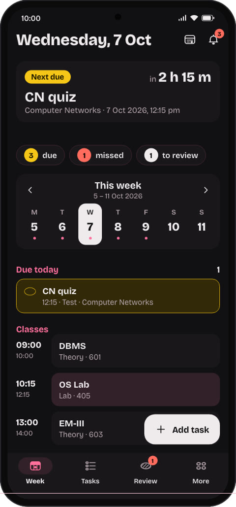<br><sub>Your week</sub> | 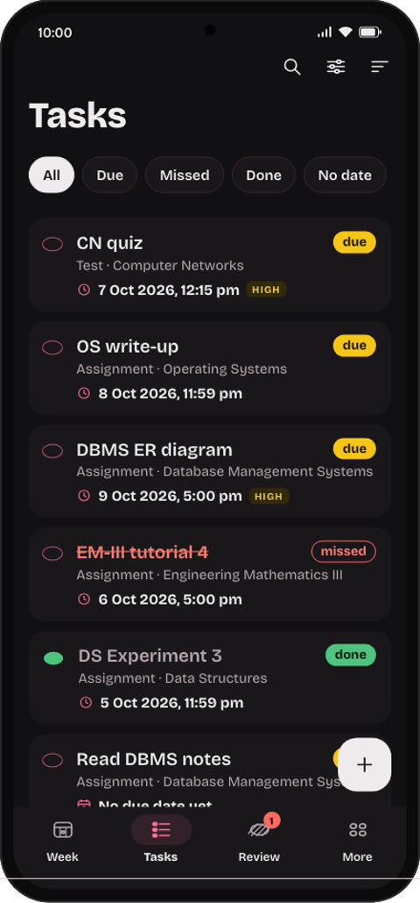<br><sub>Tasks and filters</sub> | 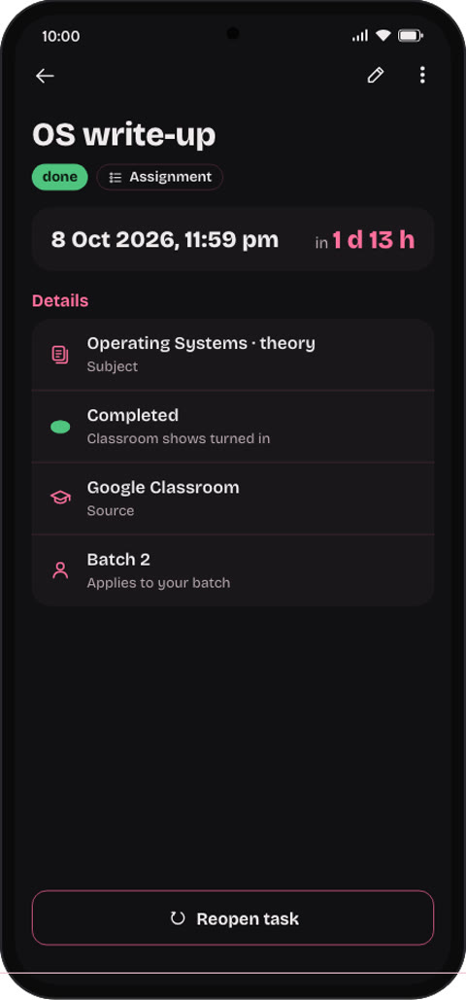<br><sub>Marked done on submission</sub> | 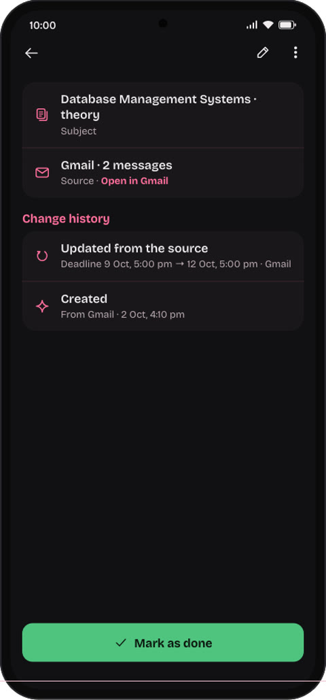<br><sub>Updated, with change history</sub> |
| 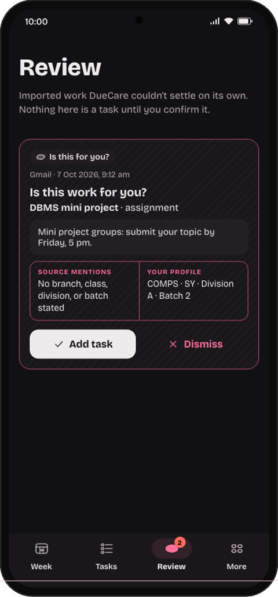<br><sub>Review questions</sub> | 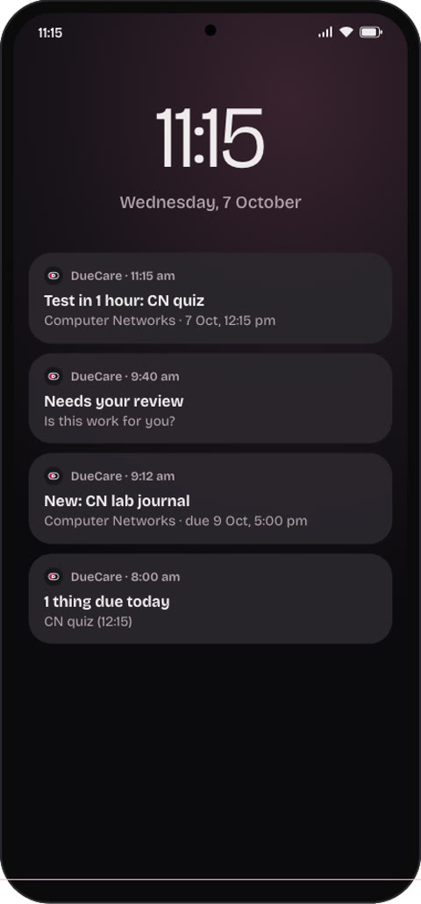<br><sub>Reminders and updates</sub> | 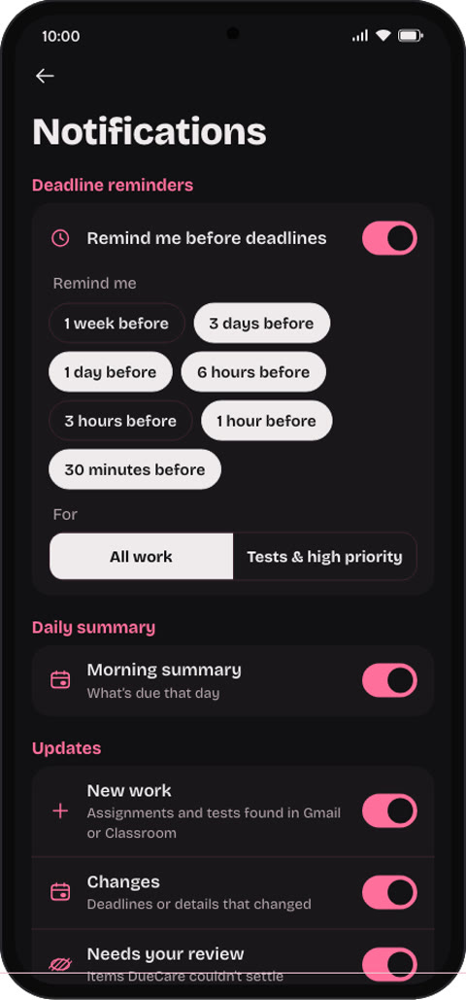<br><sub>Notification settings</sub> | 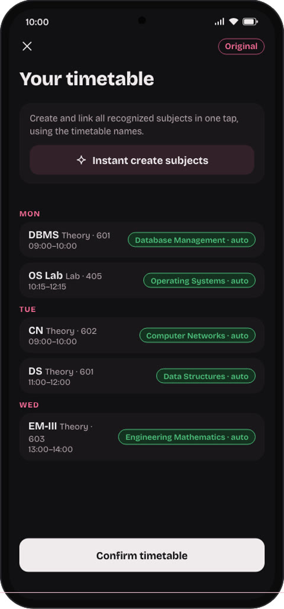<br><sub>Timetable import</sub> |
| 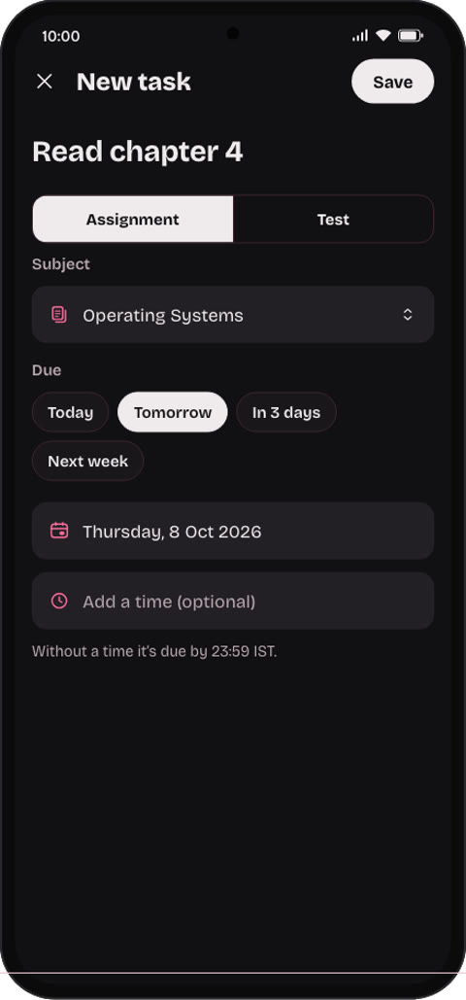<br><sub>Adding a task</sub> | 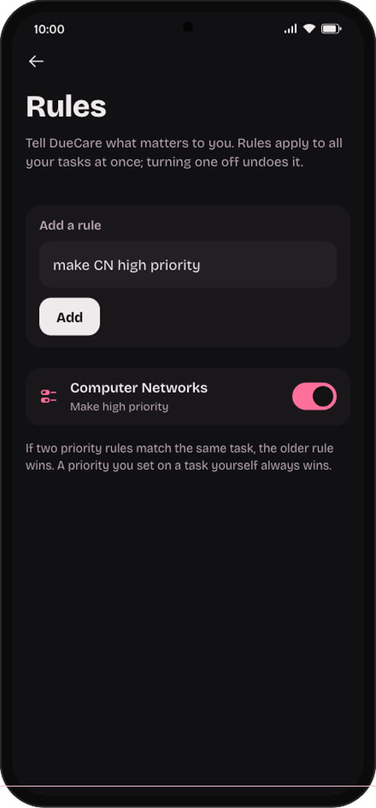<br><sub>Rules</sub> | 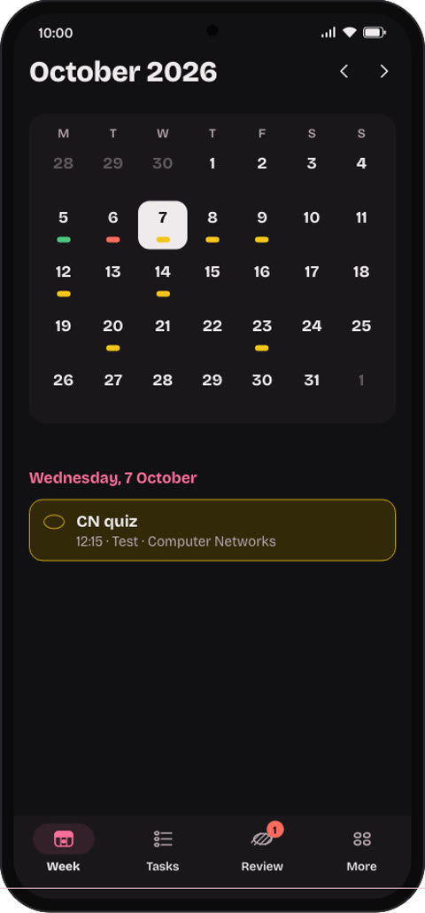<br><sub>Month view</sub> | 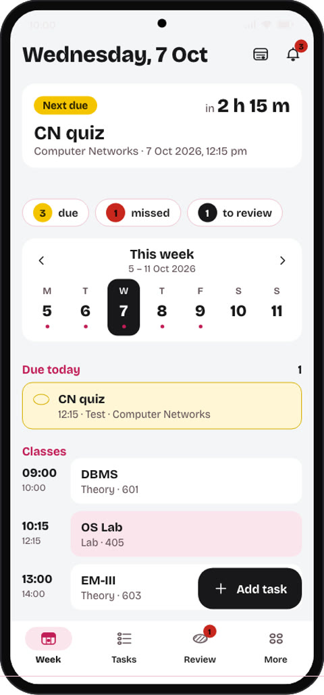<br><sub>Light appearance</sub> |

<div align="center">
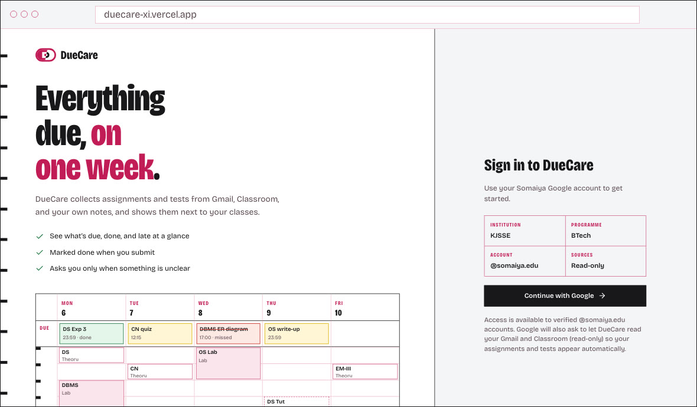<br><sub>DueCare on the web</sub>
</div>

---

## How it works

1. **Install the app** - Download `DueCare-1.0.0.apk` from [the latest release](https://github.com/dhruvwarriorr/DueCare/releases/latest) and open it on your phone. Allow installation from your browser or file manager if Android asks. Or use [the web app](https://duecare-xi.vercel.app).
2. **Sign in** - Continue with your verified `@somaiya.edu` Google account. Google also asks for read-only access to Gmail and Classroom.
3. **Fill in your profile** - Branch, year, semester, division, batch and roll number.
4. **Add your timetable** - Upload the PDF or scheduler screenshots, check the draft and confirm.
5. **Open your week** - Deadlines from Gmail and Classroom fill in on their own. Answer anything in Review, add your own tasks, and let reminders handle the rest.

**Android:** 7.0 or later

**Sources:** Gmail and Google Classroom (read-only), plus tasks you add yourself

**All times are in IST.**

---

## Your data, your control

- **Read-only access.** DueCare reads Gmail and Classroom. It never sends, deletes or changes anything there, and your password is never shared with DueCare.
- **Nothing becomes a task without evidence.** Every imported task shows where it came from and what changed. When the evidence isn't clear, DueCare asks you in Review.
- **AI only helps read messages.** AI is used to understand notices. It never decides whether a task is done, never creates subjects on its own, and full messages are not stored with it. Timetable files are read and not stored, and only course names may be sent to suggest which subject they belong to.
- **Disconnect anytime.** Disconnect Gmail or Classroom in Sources to stop syncing. Your tasks and imported records stay.
- **Delete anything.** Delete your imported data, or your whole account, from **More → Privacy & data**. Your Google data stays in Google.

---

## FAQ

**Who can use DueCare?**
KJSSE BTech students with a verified `@somaiya.edu` Google account. Sign-in and source access also depend on Google consent and university policies.

**Is it an app or a website?**
Both. The Android app is the main way to use DueCare. The website uses the same account and the same data, so anything you do on one shows up on the other.

**Do I have to connect Gmail and Classroom?**
No. Tasks you add yourself and your timetable work without them. Connecting them is what makes deadlines appear automatically.

**What if a notice isn't meant for me?**
DueCare checks it against your profile. Work for another division or batch is ignored. If a notice doesn't say who it's for, DueCare asks you in Review.

**Will reminders arrive exactly on time?**
Reminders may arrive a few minutes late. Turn on **Allow precise timing** in Notifications for exact times.

**Does it work without internet?**
Yes, for viewing. The app keeps your last saved week and tasks, and syncs again when you're back online.

---

<details>
<summary><b>For developers</b></summary>

### Repository layout

| Path | Contents |
| --- | --- |
| `apps/mobile/` | Flutter Android app and icon generator |
| `apps/web/` | Next.js website and same-origin API gateway |
| `apps/api/` | FastAPI service, database migrations and authorization SQL |
| `scripts/` | Signed Android release packaging |
| `supabase/` | Supabase configuration |
| `docs/screenshots/` | Images used in this README |

### Running locally

Use Node 24, Python 3.13 with uv, Flutter 3.47.7 and PostgreSQL 18. Copy the app-specific `.env.example` files and configure your own credentials before running services.

```sh
npm ci
uv sync --project apps/api --frozen
```

Start the API with `uv run --project apps/api uvicorn duecare.main:app --reload --host 127.0.0.1 --port 8000`, then run `npm run dev` in another terminal. Apply database migrations and configure Google/Supabase authorization before signing in.

See [Android setup](apps/mobile/README.md) for the mobile app. Run `scripts/build-android-release.sh` to build a signed APK after configuring its permanent signing key.

Environment files, signing keys, Firebase build configuration, generated binaries and private reference material are excluded from source control. APKs belong in GitHub Releases rather than the source tree.

</details>

---

<div align="center">

Built by **Dhruv Kumar**

</div>
