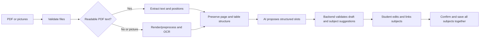

# Timetable upload, interpretation, and confirmation plan

Date: 9 October 2026. Status: implemented 9 October 2026. Section 12 records where the implementation differs from this proposal.

## 1. Intended result

Students upload one PDF or one/two timetable pictures. DueCare reads the document, proposes weekly class slots, and lets students correct the schedule and link every included slot to an existing subject before confirming. Confirmed slots appear in each subject's existing Timetable dialog.

The saved relationship must be exact: every slot references an existing subject ID owned by the student. AI recognition can be imperfect, so ambiguous subject labels require a student decision rather than a guessed link.

User-confirmed requirements:

- PDF and picture uploads.
- Text extraction followed by AI interpretation.
- An editable preview before confirmation.
- Correct linking between subject records and timetable slots, with a manual linking option when interpretation is unclear.

The limits and implementation choices below are proposed defaults, not previously approved product requirements.

## 2. Existing foundations and changes needed

| Current foundation | Planned use or change |
| --- | --- |
| `apps/web/src/components/subjects.tsx` has subject cards and a per-subject weekly-slot editor | Add an Upload timetable action beside Add subject, and connect the import preview to those same subject records |
| `apps/api/duecare/main.py` implements `GET/PUT /subjects/{id}/timetable` | Share validation/save helpers and add a bulk confirmation endpoint for multiple subjects |
| `apps/api/duecare/schemas.py` validates weekdays, times, and validity bounds | Reuse confirmed-slot validation; add a separate draft schema that permits unresolved fields |
| `apps/api/duecare/models.py` stores slots with an owner/subject foreign key | Store confirmed imports in the existing slot table, using stable subject and slot IDs |
| `apps/api/duecare/ai.py` implements typed structured responses | Add a dedicated timetable prompt and output schema using the existing configured providers |
| The web API helper and gateway currently forward JSON | Add bounded multipart upload support and explicit extraction/interpretation timeouts |

Source reconciliation needed during implementation: the current AI code/configuration uses Groq followed by configured fallbacks, while part of ProjectDocumentation.md still describes OpenAI as primary. Follow the actual configured provider service and update the relevant documentation to agree.

The existing specification describes manually entered timetable context and excludes attachment contents from the source-import AI flow. This feature adds an explicit student-upload workflow; document that scope and its retention policy before implementation. Reading Gmail/Classroom attachments is a separate workflow and is not authorized by this proposal.

## 3. Student flow

1. Open Subjects and select **Upload timetable**.
2. Choose one PDF or up to two PNG/JPEG pictures. Show previews and let the student reorder or remove pictures before processing.
3. Show **Reading your timetable**, then **Organizing your timetable** as the two real processing stages run. Avoid fabricated percentage progress.
4. Display the original document alongside an editable list grouped by subject. On smaller screens, switch between the original and the draft.
5. Review subject links, days, start/end times, rooms, and instructors. Add missed slots, remove unwanted slots, or exclude entries that cannot be resolved.
6. Review the save summary, including additions, duplicates, and any explicitly selected replacements.
7. Select **Confirm timetable**. Save all selected subject schedules together, then refresh the subject cards and their existing timetable dialogs.

The preview should show a concrete count such as “12 slots ready · 2 need a subject.” Use clear issues such as “Choose a subject” and “Check this time,” without numeric trust scores.

## 4. Subject linking rules

This is a required review step, including for names that AI appears to recognize.

Each proposed row contains:

- The label read from the document, for example `COA`, `DBMS (P)`, or an incomplete abbreviation.
- The detected component, when present: theory, lab, or tutorial.
- A suggested existing subject and its component, or an unresolved selection.
- An editable subject dropdown containing only the student's existing subjects.
- A reference to the source page/picture and relevant text region.

Apply these rules:

1. The backend supplies the current subject IDs, names, kinds, codes, and aliases as permitted candidates. The AI may suggest a supplied ID or return null.
2. A unique exact name/code/alias match with an explicitly compatible component can be preselected. Case/spacing normalization is allowed. A match with multiple candidates remains unresolved.
3. AI or fuzzy name matches are suggestions displayed for review. Similar names alone cannot establish the link. For example, a code shared by DBMS theory and DBMS lab does not identify the component.
4. Missing component information may be preselected only when the complete label uniquely identifies one existing subject. If the source says `DBMS` and both components are plausible, require a choice.
5. The student can override any preselected subject. Changing the subject changes the saved canonical ID, not merely the display label.
6. Offer **Link all matching entries** for rows with the same extracted label, component, and applicable source context. Show the affected count. Keep a per-row override because one abbreviation can represent different components.
7. Every included row needs a selected subject before confirmation. An unresolved row can be fixed or explicitly excluded; it cannot be silently discarded.
8. If the subject is missing, offer the existing Add subject form as a separate explicit student action. Refresh candidate choices afterward and return to the retained preview. AI must not create subject records.
9. Keep mappings local to this import initially. Repeated label linking within the preview does not silently add persistent aliases or change source-course links. Persistent aliases can be a later explicit feature.

Example:

| Extracted label | Linking result | Student action |
| --- | --- | --- |
| `COA` with an unambiguous theory label | Suggest the existing COA theory record | Review or change |
| `DBMS (P)` where practical clearly means lab | Suggest the existing DBMS LAB record | Review or change |
| `DBMS` with theory and lab candidates | Leave unresolved | Choose the correct component |
| An unreadable abbreviation | Leave unresolved and show the source region | Choose a subject or exclude the row |

Use the current profile to check class, semester, division, and batch. Explicitly incompatible source entries are excluded visibly. Ambiguous applicability requires review. An uploaded timetable cannot change the student's profile or introduce subject-level batch membership.

## 5. Extraction and AI pipeline

### Read text without losing the timetable layout

- For PDFs, try native text extraction page by page. A PDF can contain both readable and scanned pages; route each page separately.
- Proposed tool: pdfplumber for native text, word positions, and table information. It works best with generated PDFs and is not itself the OCR engine. Its project documents Python 3.13 support, matching this API's runtime. [pdfplumber documentation](https://github.com/jsvine/pdfplumber)
- For scanned pages and pictures, use a bounded PDF renderer/image decoder and local Tesseract OCR. Obtain word positions through TSV output, not only plain text. [Tesseract TSV output](https://tesseract-ocr.github.io/tessdoc/Command-Line-Usage.html#tsv-output)
- Apply image orientation, sensible resolution, contrast, and deskew preprocessing where useful. Pick the PDF renderer after a Python 3.13 dependency check; do not assume the OCR engine reads PDFs directly.
- Preserve page IDs, normalized word coordinates, row/column relationships, day headings, time headings, and legends. Use consistent coordinates so the original preview can highlight an entry.
- Treat both pictures as pages of one document. Resolve repeated content without merging genuinely different class slots. Preserve separate-page headings and legends.
- Assess text usability using timetable headings and recoverable content, not simply whether any text was extracted. Sparse or broken PDF text may require OCR for affected regions.

Tesseract documents limitations with table recognition. Evaluate complete timetable reconstruction early, particularly merged lab cells and multi-column grids. If OCR plus layout reconstruction fails on representative samples, compare a layout-aware OCR service or vision model before building the final integration. Changing that route would require checking provider configuration and the proposed data handling. [Tesseract table limitations](https://tesseract-ocr.github.io/tessdoc/ImproveQuality.html#tables-recognition)

### Ask AI to organize the extracted evidence

Send the necessary document text, layout references, source headings/legends, student academic context, and permitted existing subjects to a dedicated timetable interpreter.

The prompt requires a bounded structured response with candidate rows, unresolved questions, explicit exclusions, and source references. AI must:

- Interpret subject abbreviations, days, time ranges, and component labels from available evidence.
- Expand merged cells into a complete lab interval only when the visible headings establish its boundaries.
- Recognize breaks and free periods as non-class entries.
- Preserve ambiguity about AM/PM, day, component, room, and subject using null fields and concrete review issues.
- Keep alternating-week or rotating schedules unresolved unless the app can represent their recurrence correctly. A weekly slot must not silently stand for an alternate-week class.
- Return only supplied subject IDs or null and never invent hidden content.
- Treat uploaded text as evidence; instructions appearing in the timetable cannot change the extraction rules.

Use the existing structured-response provider abstraction, with a separate schema that permits incomplete drafts. Keep an overall interpretation deadline across model attempts and repairs; the current 45-second per-call timeout alone does not bound a fallback chain.

## 6. Draft and validation contracts

Each draft row needs a temporary ID, subject label, component hint, suggested subject ID, weekday, start/end time, optional room/instructor, source page/word references, review issues, and an include/exclude choice. Keep incomplete draft fields nullable.

The backend validates the draft and the final submission independently:

- Every candidate ID must belong to the current student; source references must point to supplied page/word IDs.
- Confirmed slots require weekday 1–7, valid local times, and an end after the start. The initial version supports sessions within one day.
- Final subjects and slot IDs must still exist and belong to the student.
- Compare duplicates using subject, day, interval, optional details, and validity context. Show exact duplicates as already present and do not insert them again.
- Flag simultaneous sessions and conflicting versions for review. Overlap is not automatically an error: the student must remove, exclude, correct, or explicitly acknowledge it.
- Required missing fields block confirmation. Optional room/instructor values can remain empty.
- A student can deliberately correct OCR/AI output. Final checks validate the student's confirmed values; they do not force those values to match faulty OCR.
- Preserve existing slot IDs and validity bounds when retaining or editing an existing slot. New imports use the current semester/term context and the existing IST timezone contract.

## 7. Saving behavior

Default to **Add to existing timetable**. Show all additions, skipped duplicates, and conflicts before confirmation.

Offer **Replace timetable for selected subjects** as an explicit alternative. Show which existing slots will be removed, and require review of that removal summary. Subjects absent from the selection retain their schedules. Reject an empty replacement in this import flow; clearing a schedule uses the existing deliberate editor action.

Implement one bulk save transaction rather than issuing separate subject saves from the browser:

1. Recheck the profile revision captured for the preview and the affected subjects' revisions.
2. Lock affected subjects in a consistent order, validate ownership, and validate every proposed slot.
3. Compute append/replacement results using the existing per-subject save rules.
4. Write all affected subjects and increment their revisions together. Roll back all changes if any group fails.
5. Reuse durable idempotency records. The browser must keep the same confirmation key and exact payload when retrying an uncertain save response; editing the payload starts a new confirmation.
6. If another tab changed the profile or subject schedules, return a conflict, retain the draft, refresh current values, and ask the student to review the changed result.

Successful saves return the actual saved subject and slot IDs. The existing subject timetable query becomes the shared source of truth for both imported and manually entered slots. Timetable changes affect future interpretation under the current rules; past accepted task timings keep their recorded basis.

## 8. API and processing lifecycle

Proposed authenticated endpoints:

| Endpoint | Purpose | Application data writes |
| --- | --- | --- |
| `POST /api/v1/timetable-imports/extract` | Accept bounded multipart files and return text/layout/page references | None |
| `POST /api/v1/timetable-imports/interpret` | Accept bounded extraction data and return an editable draft using current subject candidates | None |
| `POST /api/v1/timetable-imports/confirm` | Save the student's edited and linked rows across selected subjects | One atomic transaction |

Splitting extraction and interpretation gives real stage feedback and permits retrying AI without repeating OCR. Refreshing the page ends an unfinished draft in the first version; explain this before the student leaves. Durable resumable import jobs can be added later if measured processing or recovery needs justify them.

Keep existing session, ownership, Origin, CSRF, account-deletion, and cache protections on all endpoints. Add multipart handling to the gateway and upload helper without converting binary files to text or forcing the JSON Content-Type. Add the required multipart dependency to FastAPI.

Proposed starting budgets: 45 seconds for extraction, 60 seconds total for interpretation, and gateway deadlines with modest headroom for those routes. Keep ordinary API timeouts unchanged. Bound parser/OCR processes, provider attempts, and concurrent work; validate the budgets on the evaluation set before finalizing them.

## 9. Files, privacy, and proposed limits

Proposed first-version limits: one PDF with up to four pages, or up to two PNG/JPEG pictures; 10 MiB per file and 20 MiB total. Reject mixed PDF/picture submissions with a clear message. These limits need evaluation against normal phone photos and actual timetables.

Validate decoded file type, byte size, page count, image dimensions, expanded pixel count, extraction length, and candidate count on the server and gateway. Reject encrypted/corrupt PDFs with an actionable message. Suggested additional caps: 24 megapixels per decoded page/image, 20,000 extracted characters, 1 MiB layout payload, and 100 draft slots; tune after evaluation and never silently truncate a timetable.

Use temporary private files only while needed for extraction. Clean up after success, failure, timeout, and cancellation; also remove abandoned temporary artifacts after crashes. No uploaded originals, full OCR output, or full prompts go into application databases, request logs, analytics, or the repository. The browser holds original files and the working draft in memory; release object URLs and clear data when the flow closes, the account is deleted, or the session ends.

Send only necessary text/layout evidence to the configured AI provider. Display a brief notice that timetable text is interpreted using AI. Persist confirmed slots and minimal processing provenance only. Do not label an edited value as an exact original-document observation. Record safe timings/error codes and model/prompt versions without document contents.

## 10. Failure handling

| Situation | Expected behavior |
| --- | --- |
| Unreadable/cropped timetable or missing headings | Show what is missing and offer a clearer upload or manual editing |
| One picture fails | Keep the selected files; explain which one failed and allow replacement/retry |
| AI unavailable or invalid response | Keep extraction in browser memory, allow retry, and retain manual entry |
| Unknown abbreviation or ambiguous component | Require linking through the subject dropdown or excluding the row |
| Duplicate pictures or overlapping crops | Identify duplicate candidates in review; preserve independent sessions |
| Explicit other-batch timetable | Show the mismatch and exclude incompatible rows; do not rewrite the profile |
| Draft canceled | Save no timetable changes and clean up temporary data |
| Subject deleted or schedule changed while reviewing | Preserve the draft and require refreshed linking/conflict review |
| Uncertain confirmation response | Retry with the original idempotency key; check saved results without duplicating slots |

## 11. Implementation sequence and acceptance

| Phase | Deliverable | Acceptance |
| --- | --- | --- |
| 1. Extraction evaluation | Minimal redacted fixtures covering native/scanned PDFs and one/two pictures; manually checked expected subjects and slots | Verify native extraction, table positions, merged cells, cropped headers, and duplicate-page behavior; decide whether proposed local OCR is sufficient |
| 2. Extraction and interpretation | Bounded upload gateway, extractor, timetable AI schema/prompt, and deterministic validation | Drafts preserve unresolved fields; provider failure and malformed output cannot save schedules or invent subject IDs |
| 3. Subject linking and preview | Upload action, original preview, editable rows, linking controls, group linking, exclusions, issue summary | Every included row has an explicit subject link; theory/lab/tutorial remain separate; corrections persist through retry and conflict review |
| 4. Atomic confirmation | Shared save helper, bulk endpoint, append/replacement summary, stable retries, cache refresh | All selected subjects save together or none do; existing dialogs show the exact confirmed slots; retries do not duplicate rows |
| 5. Full flow and documentation | Focused API/browser checks, operational setup notes, reconciled feature/provider/retention documentation | Verify uploads through the actual web gateway and API, linking ambiguity, replacements, concurrency, cancellation, and cleanup |

Meaningful checks include cross-user subject/slot rejection, invalid time intervals, duplicate uploads, conflicting subject revisions, double confirmation, no writes before confirmation, and a failure in one subject rolling back every affected subject.

Compare complete interpreted schedules against expected rows, including subject component and time placement, rather than measuring OCR text quality alone. Record any missed, invented, or wrongly linked slots and whether the preview makes the issue recoverable. Redacted fixture success establishes local behavior; representative live OCR/provider and browser runs are still required before calling the upload feature reliable.

The implementation should preserve unrelated local edits and remain uncommitted until the user authorizes a commit. No automatic push.

## 12. Implementation notes (9 October 2026)

Evaluated against the department's SY/TY/LY division timetables (ten generated PDFs) and three overlapping scheduler screenshots covering 07:00–19:45. All 25 scheduler classes were read with correct day, time and course code. These files stay outside the repository. Tests use a synthetic PDF (`apps/api/tests/timetable_pdf.py`) and drawn scheduler screenshots (`apps/api/tests/scheduler_png.py`).

| Proposal | Implemented | Reason |
| --- | --- | --- |
| pdfplumber for native PDFs | pdfplumber table cells plus text runs in content-stream order, each placed by its first character | Narrow batch columns (LY) print text wider than the cell; position-based word grouping interleaved neighbouring cells |
| AI proposes structured slots from extracted text | Grid reconstruction is deterministic: weekday from the header column, time span from the rows a cell covers, batch/group/room/instructor parsed from the cell text. AI only suggests subject links | The college PDFs carry complete grid geometry, so a deterministic read is exact and needs no AI; AI is used where judgement is needed (abbreviation to subject) |
| Pictures of any timetable and scanned pages, via Tesseract table OCR | Exactly two inputs (student decision): the department PDF, or Somaiya roster scheduler Week-view screenshots (up to four). Screenshots use pixel geometry (ruling lines, coloured class blocks) plus local Tesseract OCR on small crops; no AI reads files. Scanned PDFs are rejected with guidance | Whole-page OCR garbled hour labels and white-on-colour text; the scheduler's fixed grid makes geometry exact, and OCR of enlarged single-block crops read every course code correctly. A vision model was tried first and removed at the student's request |
| Batch applicability | Batch-labelled cells (`A1`, `B2`) follow the profile batch automatically and remain visible as not included. Numbered groups (`DA_1`) and one course in several rooms at one time become explicit choices. A header naming another class year or division excludes its rows until the student includes them | User requirement: tutorials and labs are split into side-by-side batch columns within the same time block |
| AM/PM | Rows read top to bottom; a time earlier than the previous row is afternoon (`12:00-1:00` is 12:00–13:00). A first row before 7:00 is assumed afternoon and flagged | Printed timetables omit AM/PM; row order is the evidence |
| Rule 8: missing subjects via the existing Add subject form | Also a per-course **Create subject from this** (student decision), prefilled from the timetable and editable. Duplicate name+kind subjects are refused in the UI and API | Avoids retyping every course; a student action, never AI-created |
| Electives, honours and minors | Course families (`E-ACC` theory + `E-ACC_n` labs; `H-CSFTUT`/`H_CSF`) chosen from a checklist; class-wide `Minor`/`EL` placeholders kept; parallel sessions chosen once per teacher | LY/TY sheets list every elective; without this, each elective and each day needed manual exclusion |
| Department timetable pictures and scans | Ruled-grid reconstruction from pixels plus per-cell Tesseract OCR, using the PDF reader's weekday/time logic and structural repairs | The FY scan and the TY honours sheet exist only as images |
| Confirmation summary | `POST /timetable-imports/confirm` with `dryRun: true` computes the same summary the save uses: added, already saved, updated (replace), removed (replace), overlaps, repeated rows | One server-side source of truth for the preview and the write |

Known limits: `HH:MM:SS` is the stored slot time format for both editors. Alternate-week schedules are not detected. Scheduler screenshots must be the Week view at normal zoom. A class never fully visible in any screenshot keeps a flagged, checkable time. Two different courses with nearly identical block colours that touch in time and are cut off across screenshots could be joined; their course codes are compared when readable. Live AI suggestions were not exercised because the configured Groq key was rejected (`401`) during implementation; the import shows "suggestions unavailable" and remains fully usable with exact, sibling and initials matching.
